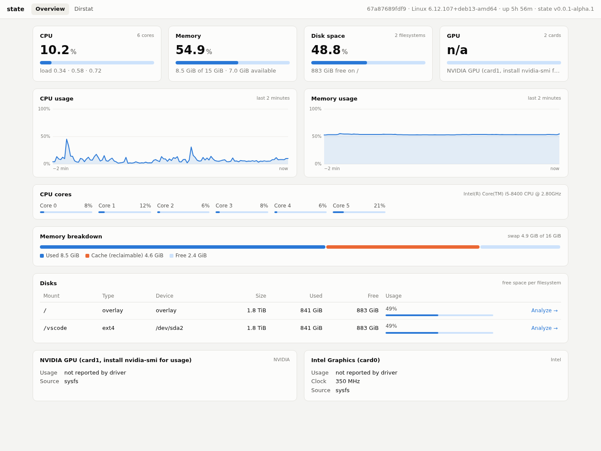
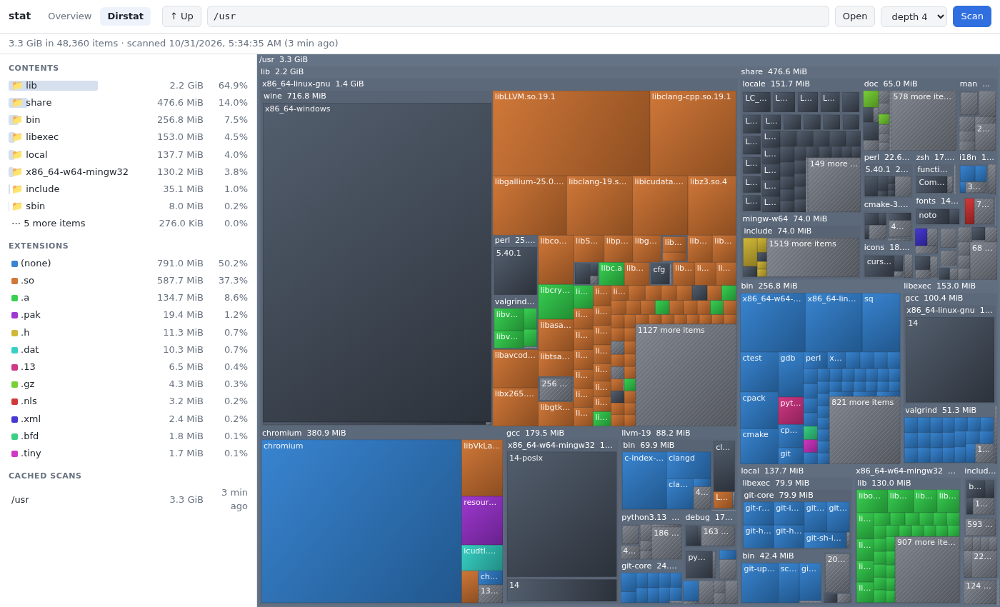

# About this program

This program for monitoryng system info.

Program name `state`

Should support `linux` and `windows`.

## Dirstat. First functional i want to add research disk space, which folder, file takes up space

Alternative program is https://windirstat.net

Program should support cli and api

Server mode
```bash
state -s 127.0.0.1:8084
```

Example usage.
 
```bash
# reasearch all system space, 
# after that, should cache result
state dirstat -s (--scan) /

# show like three from cached result
## should visible when was scanned this path
state dirstat -t (--three) /

```

On api dirstast, should return result, which will used show Squares on html, like on windirstat.


---

## Screenshots

**Overview** (`/`): CPU, memory, disks and free space, GPU, updated every second.

<picture>
  <source media="(prefers-color-scheme: dark)" srcset="docs/screenshots/overview-dark.png">
  
</picture>

**Dirstat** (`/dirstat`): which folders and files take up space, drawn as a treemap like WinDirStat. Click a square to zoom in.

<picture>
  <source media="(prefers-color-scheme: dark)" srcset="docs/screenshots/dirstat-dark.png">
  
</picture>

**Terminal**

```text
$ state
67a87689fdf9 · Linux 6.12.107+deb13-amd64 · up 5h 41m · 2026-10-31 05:36:30

CPU      Intel(R) Core(TM) i5-8400 CPU @ 2.80GHz · 6 cores · load 1.47 1.18 0.88
         [###                           ]  10.2%
           0 [#         ]   6%    1 [#         ]   8%    2 [          ]   4%    3 [#         ]  12%
           4 [###       ]  25%    5 [          ]   4%

Memory   [################              ]  52.7%  8.2 GiB used of 15.5 GiB · 7.3 GiB available
Swap     [#########                     ]  30.6%  4.9 GiB used of 15.9 GiB

Disks
  MOUNT    TYPE           SIZE       USED       FREE                USE%
  /        overlay     1.8 TiB  840.8 GiB  883.0 GiB  [#####     ]   49%

GPU
  Intel Graphics (card0)
         usage not available · 350 MHz
```

```text
$ state dirstat --tree /usr -d 1 -n 4
Path:    /usr
Scanned: 2026-10-31 05:34:35 (1 minutes ago)
Total:   3.3 GiB in 48360 items

   3.3 GiB 100.0% [####################]  /usr/
   2.2 GiB  64.9% [#############       ]  ├── lib/
 476.6 MiB  14.0% [###                 ]  ├── share/
 256.8 MiB   7.5% [##                  ]  ├── bin/
 153.0 MiB   4.5% [#                   ]  ├── libexec/
 311.4 MiB   9.1% [##                  ]  └── … 9 more
```

## Download

Prebuilt binaries for Linux (x86_64) and Windows (x86_64, Windows 10+) are on the
[Releases](https://github.com/wildwind123/state/releases) page. Each one is a single
file with nothing to install:

```bash
# Linux
tar xzf state-*-linux-x86_64.tar.gz
./stat-*-linux-x86_64/stat
```

On Windows, unzip `state-…-windows-x86_64.zip` and run `state.exe` from a terminal
(`state.exe -s 127.0.0.1:8084`, then open http://127.0.0.1:8084/).

`SHA256SUMS.txt` in each release lists checksums for verifying downloads.

### Making a release

Push a tag that starts with `v`. GitHub Actions builds both platforms, runs smoke
tests, and publishes the release. Tags with a suffix such as `-alpha.0` are marked
as pre-releases.

```bash
git tag v0.0.1-alpha.1
git push origin v0.0.1-alpha.1
```

## Build

```bash
cmake -S . -B build -G Ninja
cmake --build build
./build/state --help
```


### Windows

`state.exe` is built with MinGW-w64 (Windows 10 or newer). It is a single static
file with no DLLs to ship.

Cross-compile from Linux (the dev container has the toolchain):

```bash
cmake -S . -B build-win -G Ninja -DCMAKE_TOOLCHAIN_FILE=cmake/mingw-w64.cmake
cmake --build build-win          # -> build-win/state.exe
```

Or build on Windows in an [MSYS2](https://www.msys2.org/) UCRT64 shell:

```bash
pacman -S mingw-w64-ucrt-x86_64-gcc mingw-w64-ucrt-x86_64-cmake mingw-w64-ucrt-x86_64-ninja
cmake -S . -B build -G Ninja && cmake --build build
```

MSVC is not supported (the code uses pthreads and `getopt_long`, which MinGW provides).

On Windows, paths are shown with forward slashes (`C:/Users`). Input accepts
either `C:\Users` or `C:/Users`, and matching is case-insensitive.

| | Linux | Windows |
|---|---|---|
| CPU | `/proc/stat` | `GetSystemTimes`, `NtQuerySystemInformation` (per core) |
| Load average | `/proc/loadavg` | not available (shows uptime instead) |
| Memory / swap | `/proc/meminfo` | `GlobalMemoryStatusEx`; page files as swap |
| Disks | mounted filesystems | drive letters (`C:/`, `D:/`, network drives) |
| GPU | `nvidia-smi`; AMD and Intel via `/sys/class/drm` | `nvidia-smi`; any vendor via DXGI + the "GPU Engine" performance counters Task Manager uses |
| Dirstat sizes | allocated blocks; hard links once | size rounded up to the cluster size (real allocation for compressed, sparse and OneDrive files); hard links counted per link, like Explorer |
| Links | symlinks not followed | junctions and symlinks not followed |
| Cache | `~/.cache/state/dirstat` | `%LOCALAPPDATA%\state\dirstat` |

Run as Administrator to scan folders such as `C:\Windows\System32\config`.
Otherwise they are counted as unreadable.

## CLI

```bash
state                             # system overview: CPU, memory, swap, disks/free space, GPU
state --json                      # the same as JSON (same format as /api/system)
state dirstat --scan /            # scan, cache the result, print a summary
state dirstat --tree /usr -d 3    # tree from the cache (also: -t, --three)
state dirstat --list              # cached scans and when they were made
state dirstat --tree /usr --json  # same JSON as the API
```

| option | meaning |
|---|---|
| `-d, --depth N` | tree levels to show (default 2, 0 = unlimited) |
| `-n, --top N` | biggest entries per directory (default 10, 0 = all) |
| `-x, --one-file-system` | do not cross into other filesystems while scanning |
| `-j, --json` | JSON output |
| `-q, --quiet` | no progress/summary |

`--tree` works for any path inside a cached scan. If you scanned `/`, then
`state dirstat -t /home` reads from that scan, and the output shows when the scan ran.
If several scans contain the path, the newest one is used.

Sizes are bytes on disk (like `du`). Hard links are counted once.
Virtual filesystems (`/proc`, `/sys`, cgroup, …) are skipped.

Cache: `$STATE_CACHE_DIR`, else `$XDG_CACHE_HOME/state/dirstat`, else `~/.cache/state/dirstat`
(Windows: `%LOCALAPPDATA%\state\dirstat`).

## Server / API

```bash
state -s 127.0.0.1:8084
```

| page | what it shows |
|---|---|
| http://127.0.0.1:8084/ | live overview: CPU (total + per core, 2‑minute history), memory, disks and free space, GPU |
| http://127.0.0.1:8084/dirstat | disk-usage treemap (squares like WinDirStat; click to zoom in) |

The "Analyze →" link next to each disk on the overview page opens that mount point in dirstat.

| method | endpoint | description |
|---|---|---|
| GET | `/api/system` | snapshot: cpu, memory, disks, gpus (CPU sampled every 1 s, GPU every 2 s) |
| GET | `/api/system/history` | last 2 minutes of CPU and memory usage, one sample per second |
| GET | `/api/dirstat?path=/usr&depth=3&limit=1000&min=0.0005` | tree from cache |
| POST | `/api/dirstat/scan?path=/` | start a background scan (`202`, or `409` if one is running) |
| GET | `/api/dirstat/status` | progress of the current/last scan |
| GET | `/api/dirstat/scans` | list cached scans |

`/api/dirstat` response:

```json
{
  "root": "/", "path": "/usr", "scanned_at": 1793421743, "duration_ms": 2628, "errors": 4,
  "tree": {
    "name": "/usr", "type": "dir", "size": 1602277376, "items": 34124,
    "children": [
      { "name": "lib", "type": "dir", "size": 786501632, "items": 6821, "truncated": true },
      { "name": "7 more items", "type": "rest", "size": 350027776, "items": 4629, "count": 7 }
    ]
  }
}
```

- `type`: `dir`, `file`, `other`, or `rest` (smaller siblings grouped into one entry)
- `truncated`: the directory has children below the requested `depth`
GPU data: NVIDIA comes from `nvidia-smi` (it must be installed), AMD from
`/sys/class/drm` (usage, VRAM, temperature). Intel only reports clock speed, because
its driver does not expose a usage percentage. Values a driver doesn't report are `null`.

- `min`: siblings smaller than this share of the requested node are grouped into `rest`, which keeps responses small enough to draw

## License

[MIT](LICENSE)
